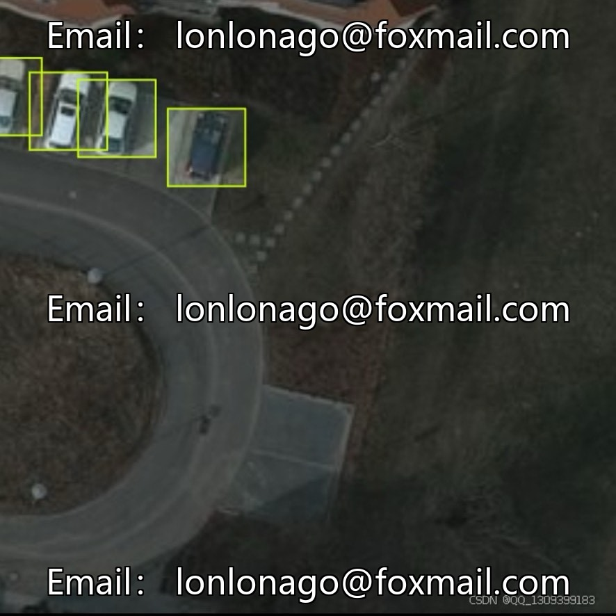
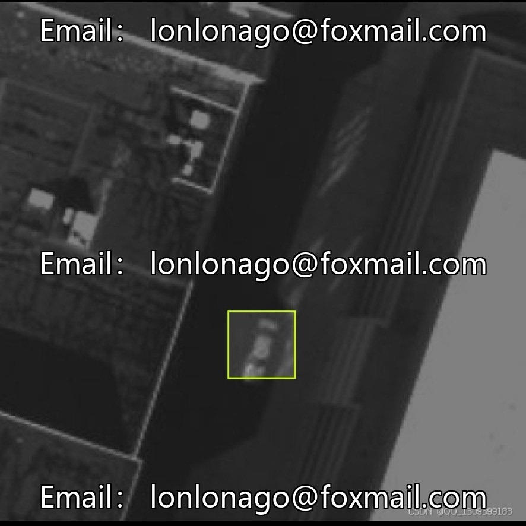
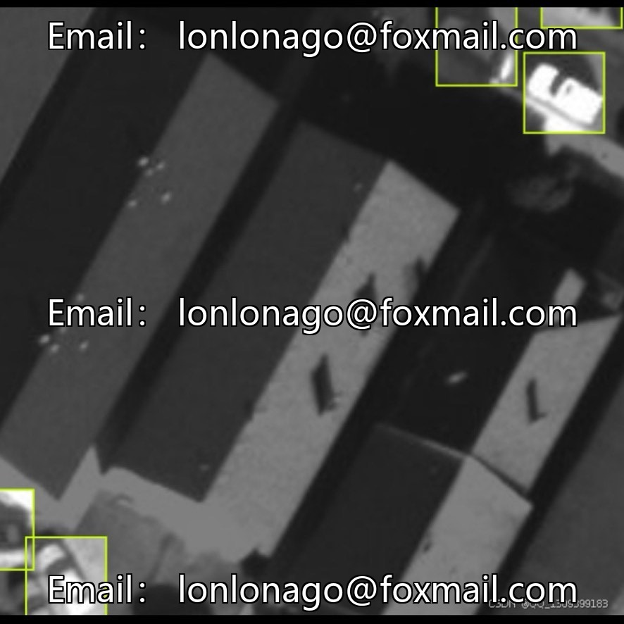
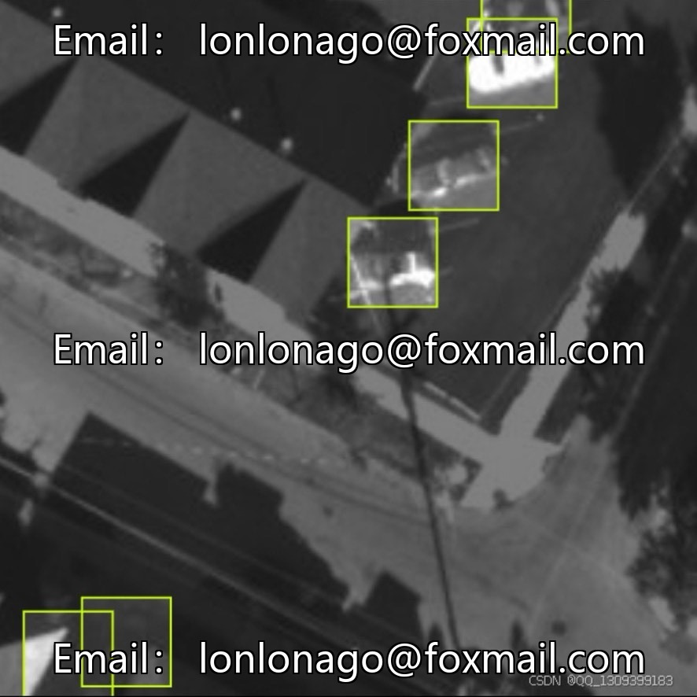
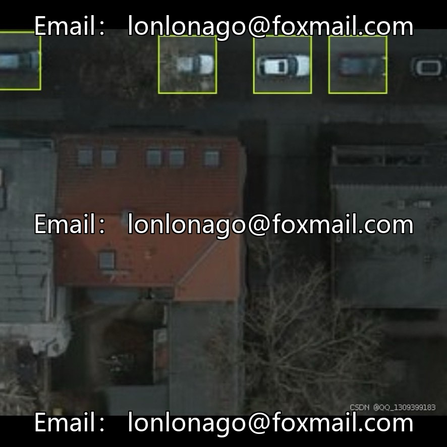

# Drone Aerial Rescue Target Detection Dataset, Issue 10031, for Low-altitude Emergency Rescue

## Body

Drone Airborne Rescue Target Detection Dataset, Issue 10031, targeting low-altitude emergency rescue aerial photography scenarios, suitable for the development of drone disaster inspection and search and rescue recognition algorithms.

The dataset consists of 5096 aerial images, medium-sized, covering complex rescue environments such as fires, wilderness, and urban areas. The three types of annotation systems: Fire (fire), Human (people), Vehicle (vehicle), form an integrated detection logic of "disaster-personnel-rescue equipment". The image resolution is diverse, taking into account the recognition of distant small targets, and it is computationally friendly, which can be deployed in drone embedded devices.

The dataset does not have an official fixed split ratio. The standard allocation is 70%-80% for the training set (approximately 3500–4000 images), 20%-30% for the test set (approximately 1000–1500 images), with some additional partitioning for validation sets to tune hyperparameters.

Core application scenarios: natural disaster rescue, wilderness search and rescue, urban security, visuals of rescue robots, algorithm academic research, etc.

Virtual materials, once sold, are non-refundable.
Interested friends, click "I want" to proceed.

## Images

## Payment

Here is a pay link on Stripe ( https://buy.stripe.com/3cs8yP7sY87d0vu9AB ). Please contact me lonlonago@foxmail.com after funding $89, and I will send you a complete data files , thank you!

